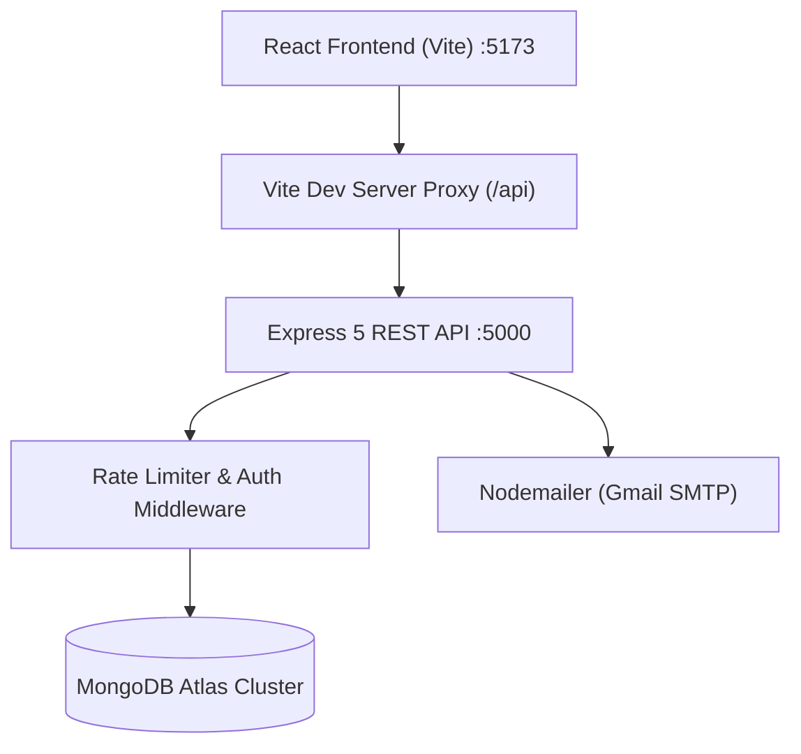

# HireHub — Modern MERN Stack Job & Career Portal

HireHub is a full-featured, production-ready MERN (MongoDB, Express, React, Node.js) web application designed to connect job seekers with employers through verified hiring workflows, real-time application tracking, and role-based access controls.

---

## Table of Contents

- [Overview](#overview)
- [Key Features](#key-features)
- [Technology Stack](#technology-stack)
- [System Architecture](#system-architecture)
- [Project Directory Structure](#project-directory-structure)
- [Prerequisites](#prerequisites)
- [Environment Configuration](#environment-configuration)
- [Installation & Local Setup](#installation--local-setup)
- [API Documentation](#api-documentation)
- [Security & Authentication Architecture](#security--authentication-architecture)
- [Automated Testing](#automated-testing)
- [Deployment Guidance](#deployment-guidance)
- [Known Limitations](#known-limitations)
- [Portfolio & Resume Summary](#portfolio--resume-summary)
- [License](#license)

---

## Overview

Modern hiring platforms often suffer from fragmented communication, automated spam applications, and cumbersome applicant review flows. **HireHub** addresses this challenge with a unified platform providing:

1. **Candidates** with verified job listings, seamless keyword/category search, instant application submission, and real-time status notifications.
2. **Recruiters** with employer branding, job management, candidate pipeline review, and status progression audits.
3. **Administrators** with system-wide moderation over users, job postings, and company verifications.

---

## Key Features

### Authentication & Account Security
- **Multi-Role Authentication**: Dedicated portals for `candidate` (job seeker), `recruiter` (employer), and `admin`.
- **Cryptographic Email Verification**: Single-use, SHA-256 hashed 24-hour verification links with replay attack prevention and rate limiting.
- **Password Recovery**: Expiring single-use reset tokens with strict password length validation and anti-enumeration safeguards.
- **Google OAuth 2.0**: Single-click sign-in with verified Google accounts.
- **Session Security**: Stateless JSON Web Tokens (JWT) with configurable expiry (`JWT_EXPIRES_IN`).

### Candidate Portal
- **Job Discovery & Search**: Filter jobs by keywords, category, work mode (Remote/On-site/Hybrid), job type (Full-time/Part-time/Contract), experience level, and salary.
- **Application Tracking**: View submitted applications with active status tracking (`Applied` &rarr; `Under Review` &rarr; `Shortlisted` &rarr; `Interview` &rarr; `Hired` / `Rejected`).
- **Profile & Resume Management**: Save personal headlines, bios, technical skills, and upload PDF/DOC resumes.
- **Saved Jobs**: Bookmark interesting listings for future review.

### Recruiter & Employer Tools
- **Company Profile Setup**: Manage company details, industry, size, website, and company logos.
- **Job Listing Management**: Create, edit, publish, pause, or remove job listings with customized salary ranges and requirements.
- **Applicant Pipeline**: Review candidates per job with applicant profiles, attached resumes, and cover notes.
- **Status Workflows**: Update candidate stages with recruiter feedback notes.

### Administrative Oversight
- **Platform Analytics**: High-level platform statistics for total users, live jobs, applications, and companies.
- **User Moderation**: View all registered users and toggle account status (`active` / `suspended`).
- **Job & Company Moderation**: Verify company legitimacy and review flagged job listings.

---

## Technology Stack

### Frontend
- **Library**: React 19 (Vite build system)
- **Routing**: React Router DOM v7
- **Icons**: Lucide React
- **Authentication**: Custom AuthContext + `@react-oauth/google`
- **Styling**: Vanilla CSS with modern custom properties, glassmorphism, and responsive flex/grid layouts.
- **Linting**: Oxlint

### Backend
- **Runtime**: Node.js (v18+)
- **Framework**: Express v5
- **Database**: MongoDB Atlas with Mongoose v9 ODM
- **Password Hashing**: Bcryptjs (12 salt rounds)
- **Email Delivery**: Nodemailer (Gmail SMTP with local development preview fallback)
- **Rate Limiting**: `express-rate-limit`
- **File Uploads**: Multer with strict MIME-type and 5MB size limits

---

## System Architecture



---

## Project Directory Structure

```text
hirehub2/
├── .gitignore                     # Root Git exclusions (protects secrets, uploads, node_modules)
├── README.md                      # Comprehensive project documentation
├── PORTFOLIO.md                   # Portfolio showcase and interview talking points
├── backend/
│   ├── .env.example               # Backend environment variable template
│   ├── .gitignore                 # Backend-specific ignore rules
│   ├── server.js                  # Express entry point & middleware mounting
│   ├── config/
│   │   └── db.js                  # Mongoose MongoDB Atlas connection handler
│   ├── controllers/
│   │   ├── authController.js      # Register, login, verification, password recovery
│   │   ├── jobController.js       # Job search, creation, editing, details
│   │   ├── applicationController.js # Job application lifecycle & recruiter reviews
│   │   ├── candidateController.js # Profile updates & saved jobs
│   │   ├── companyController.js   # Recruiter company management & logos
│   │   └── adminController.js     # Admin metrics and moderation
│   ├── middleware/
│   │   ├── authMiddleware.js      # JWT verification (protect) & requireVerified guard
│   │   ├── rateLimiter.js         # Endpoint rate limiting rules
│   │   └── uploadMiddleware.js    # Multer file storage & type filtering
│   ├── models/
│   │   ├── User.js                # Users with email verification & reset fields
│   │   ├── Job.js                 # Job postings schema with category & salary
│   │   ├── Application.js         # Application pipeline with statusHistory
│   │   ├── Company.js             # Employer company profile schema
│   │   └── CandidateProfile.js    # Job seeker profile & resume metadata
│   ├── routes/
│   │   ├── authRoutes.js          # /api/auth endpoints
│   │   ├── jobRoutes.js           # /api/jobs endpoints
│   │   ├── applicationRoutes.js   # /api/applications endpoints
│   │   ├── candidateRoutes.js     # /api/candidate endpoints
│   │   ├── companyRoutes.js       # /api/companies endpoints
│   │   └── adminRoutes.js         # /api/admin endpoints
│   ├── services/
│   │   └── emailService.js        # Responsive HTML verification/reset email service
│   ├── tests/
│   │   ├── unit_verification.test.js    # Email service, hashing, & token tests
│   │   ├── routes_verification.test.js  # Middleware & rate limiting tests
│   │   ├── email_verification.test.js   # Complete auth verification integration tests
│   │   └── job_portal_workflow.test.js  # Full candidate & recruiter E2E workflow tests
│   └── uploads/                   # Local uploads directory (gitignored)
│       ├── avatars/.gitkeep
│       ├── logos/.gitkeep
│       └── resumes/.gitkeep
└── frontend/
    ├── .env.example               # Frontend environment template
    ├── .gitignore                 # Frontend-specific ignore rules
    ├── index.html                 # Single page application entry HTML
    ├── vite.config.js             # Vite configuration with /api proxy to :5000
    ├── package.json               # Frontend dependencies & scripts
    └── src/
        ├── App.jsx                # Route definitions & protection wrapper
        ├── main.jsx               # React DOM root render
        ├── api/
        │   └── index.js           # Centralized API fetcher with token injection
        ├── context/
        │   └── AuthContext.jsx    # User state, login, register, token persistence
        ├── components/
        │   ├── Navbar.jsx         # Dynamic role-based navigation bar
        │   ├── Footer.jsx         # Site footer
        │   ├── ProtectedRoute.jsx # Route guard enforcing authentication & verification
        │   ├── LoadingSpinner.jsx # Animated spinner
        │   ├── Alert.jsx          # Styled alert banner
        │   └── Modal.jsx          # Accessible dialog modal
        └── pages/
            ├── Home.jsx           # Landing page with hero, featured jobs, categories
            ├── Jobs.jsx           # Paginated job browse with filter sidebar
            ├── JobDetail.jsx      # Job overview & application modal
            ├── Companies.jsx      # Directory of hiring employers
            ├── CompanyDetail.jsx  # Individual company showcase
            ├── Signup.jsx         # Role-based registration with email verification notice
            ├── auth/
            │   ├── Login.jsx      # Sign in with unverified account detection
            │   ├── VerifyEmail.jsx # 5-state token verification page
            │   ├── ResendVerification.jsx # Prefilled verification resend page
            │   ├── ForgotPassword.jsx     # Password recovery request form
            │   └── ResetPassword.jsx      # Secure password reset form
            ├── candidate/         # Candidate dashboard, applications, settings
            ├── recruiter/         # Recruiter job postings, applicants, company setup
            └── admin/             # Admin moderation panel
```

---

## Prerequisites

- **Node.js**: v18.0.0 or higher
- **npm**: v9.0.0 or higher
- **MongoDB**: Active MongoDB Atlas cluster or local MongoDB instance (v6.0+)
- **Google Cloud Console account** (optional, for Google Sign-In)
- **Gmail Account with App Password** (optional, for live email delivery)

---

## Environment Configuration

### Backend Configuration (`backend/.env`)

Copy `backend/.env.example` to `backend/.env`:

```env
PORT=5000
MONGO_URL=mongodb+srv://<username>:<password>@<cluster>.mongodb.net/hirehub?retryWrites=true&w=majority
JWT_SECRET=your_super_secret_jwt_key_at_least_32_characters_long
JWT_EXPIRES_IN=7d
FRONTEND_URL=http://localhost:5173

# Email Delivery (Optional in local development; links are printed to console if omitted)
EMAIL_HOST=smtp.gmail.com
EMAIL_PORT=587
EMAIL_USER=your_email@gmail.com
EMAIL_PASSWORD=your_16_character_google_app_password
EMAIL_FROM=HireHub <no-reply@hirehub.com>

# Optional Google OAuth
GOOGLE_CLIENT_ID=your_google_client_id.apps.googleusercontent.com
```

### Frontend Configuration (`frontend/.env`)

Copy `frontend/.env.example` to `frontend/.env`:

```env
# Leave blank for local development to use the Vite proxy at http://localhost:5000
VITE_API_URL=

# Optional Google OAuth Client ID matching the backend
VITE_GOOGLE_CLIENT_ID=your_google_client_id.apps.googleusercontent.com
```

---

## Installation & Local Setup

### 1. Clone the Repository
```bash
git clone https://github.com/your-username/hirehub.git
cd hirehub
```

### 2. Backend Setup
```bash
cd backend
npm install
npm run dev
```
The backend starts on `http://localhost:5000`.

### 3. Frontend Setup
In a second terminal:
```bash
cd frontend
npm install
npm run dev
```
The frontend is available at `http://localhost:5173`.

---

## API Documentation

### Public Endpoints
| Method | Endpoint | Description |
| :--- | :--- | :--- |
| `GET` | `/` | API health check |
| `GET` | `/api/jobs` | Paginated jobs with search and filter queries |
| `GET` | `/api/jobs/featured` | Homepage featured job listings |
| `GET` | `/api/jobs/categories` | Job categories with live counts |
| `GET` | `/api/jobs/:id` | Full job details with related recommendations |
| `GET` | `/api/companies` | List all registered companies |
| `GET` | `/api/companies/:id` | Single company profile and published jobs |

### Authentication Endpoints
| Method | Endpoint | Description |
| :--- | :--- | :--- |
| `POST` | `/api/auth/register` | Register new account (candidate or recruiter) |
| `POST` | `/api/auth/login` | Authenticate with email and password |
| `GET` | `/api/auth/verify-email/:token` | Validate single-use verification token |
| `POST` | `/api/auth/resend-verification` | Request a fresh verification link |
| `POST` | `/api/auth/forgot-password` | Dispatch password reset email |
| `POST` | `/api/auth/reset-password/:token` | Set new password with valid token |
| `POST` | `/api/auth/google` | Sign in with verified Google credential |

### Protected Candidate Endpoints (`protect`, `requireVerified`)
| Method | Endpoint | Description |
| :--- | :--- | :--- |
| `GET` | `/api/candidate/profile` | Retrieve candidate profile and resume |
| `PUT` | `/api/candidate/profile` | Update headline, skills, bio, and social links |
| `POST` | `/api/candidate/upload-resume` | Upload PDF/DOC resume file |
| `POST` | `/api/candidate/saved-jobs/:jobId` | Bookmark or unbookmark a job |
| `GET` | `/api/candidate/saved-jobs` | Retrieve all bookmarked jobs |
| `POST` | `/api/applications/apply/:jobId` | Submit job application with resume & note |
| `GET` | `/api/applications/my-applications` | Track submitted applications and status |
| `DELETE`| `/api/applications/withdraw/:id` | Withdraw an active application |

### Protected Recruiter Endpoints (`protect`, `requireVerified`, `authorize("recruiter")`)
| Method | Endpoint | Description |
| :--- | :--- | :--- |
| `GET` | `/api/jobs/recruiter/my-jobs` | List all jobs created by recruiter |
| `POST` | `/api/jobs` | Create a new job listing |
| `PUT` | `/api/jobs/:id` | Update existing job listing |
| `DELETE`| `/api/jobs/:id` | Delete job listing |
| `PATCH` | `/api/jobs/:id/status` | Change status (`published`, `draft`, `closed`) |
| `GET` | `/api/applications/recruiter` | View all candidate applications for recruiter jobs |
| `PATCH` | `/api/applications/:id/status` | Update candidate status (`Under Review`, `Interview`, `Hired`, etc.) |
| `GET` | `/api/companies/my-company` | Get recruiter's company profile |
| `POST` | `/api/companies` | Create or update company profile |
| `POST` | `/api/companies/upload-logo` | Upload employer logo image |

---

## Security & Authentication Architecture

1. **Password Hashing**: Passwords hashed with `bcryptjs` using a cost factor of 12. Plain passwords are never stored or logged.
2. **Single-Use Verification Tokens**: Tokens are generated via `crypto.randomBytes(32)` (256-bit entropy). Only their SHA-256 hashes are stored in MongoDB with a 24-hour expiration. Upon verification, the token is permanently wiped from the database to prevent replay attacks.
3. **Defense Against Email Enumeration**: Password reset and verification resend endpoints return uniform success responses regardless of whether the email exists in the database.
4. **Access Control & Verification Guard**: The `requireVerified` middleware prevents unverified accounts from creating jobs or submitting applications even if an attacker possesses a stale session.
5. **Rate Limiting**: Configured with `express-rate-limit` to prevent brute force and email spamming on auth routes.
6. **Strict Git Isolation**: Multi-tier `.gitignore` files at the root, backend, and frontend ensure that `.env` files and user-uploaded resumes are never committed to version control.

---

## Automated Testing

HireHub includes a comprehensive automated test suite in `backend/tests/`:

```bash
cd backend

# Run unit tests and route middleware tests
npm test

# Run complete email verification integration tests against the database
npm run test:integration

# Run complete candidate/recruiter end-to-end workflow tests
node tests/job_portal_workflow.test.js
```

### Test Suite Coverage
- `unit_verification.test.js`: 14 tests (token entropy, deterministic SHA-256 hashing, 24h expiry logic, email templates, dev logger fallback, input validation).
- `routes_verification.test.js`: 3 tests (`requireVerified` guard blocks unverified, allows verified, rate limiting triggers 429).
- `email_verification.test.js`: 19 tests (registration, token verification, expired tokens, replay prevention, resend invalidation, login block, password reset).
- `job_portal_workflow.test.js`: 18 tests (full candidate & recruiter lifecycles, job creation, application submission, duplicate prevention, status updates, resource ownership).

**Total: 54 / 54 tests passing.**

---

## Deployment Guidance

### Frontend (e.g. Vercel / Netlify)
1. Set the root directory to `frontend`.
2. Build command: `npm run build`
3. Output directory: `dist`
4. Set environment variable: `VITE_API_URL=https://your-backend-domain.com`

### Backend (e.g. Render / Railway / AWS EC2)
1. Set the root directory to `backend`.
2. Build command: `npm install`
3. Start command: `node server.js`
4. Configure all environment variables from `backend/.env.example`.
5. Ensure your MongoDB Atlas cluster has the hosting provider's IP whitelisted in **Network Access**.

---

## Known Limitations

- **File Upload Storage**: File uploads are currently stored on the local filesystem in `backend/uploads/`. For production scale across serverless or containerized platforms, an S3-compatible cloud storage bucket (e.g. AWS S3, Cloudinary) should be configured.
- **WebSocket Notifications**: Status updates are fetched via REST polling and page refreshes. Real-time in-app push notifications using WebSockets (Socket.io) can be added as a future enhancement.

---

## License

This project is licensed under the MIT License — see the LICENSE file for details.
